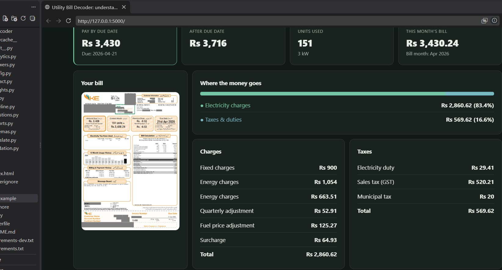

# Utility Bill Decoder

Utility Bill Decoder is a web app for understanding Pakistani electricity bills from K-Electric, LESCO, and IESCO. Upload a bill image to extract printed charges and readings, review usage trends, get grounded answers, and export a report.

The interface supports English, Roman Urdu, and Urdu, includes light and dark themes, and adapts to mobile screens.



## Contents

- [Features](#features)
- [How an analysis works](#how-an-analysis-works)
- [Technology](#technology)
- [Requirements](#requirements)
- [Local setup](#local-setup)
- [Run the web app](#run-the-web-app)
- [Configuration](#configuration)
- [Web API](#web-api)
- [Batch CSV processing](#batch-csv-processing)
- [Run tests](#run-tests)
- [Data handling and limitations](#data-handling-and-limitations)
- [Project structure](#project-structure)
- [Troubleshooting](#troubleshooting)

## Features

### Bill extraction and overview

- Upload a PNG, JPG/JPEG, or WEBP bill image by selecting a file or dropping it onto the upload area.
- Extract provider, tariff, bill month, dates, meter readings, units, charges, taxes, arrears, and payable amounts into structured data.
- Review the uploaded bill alongside extracted totals and itemized charge and tax lines.
- View validation warnings when extracted line items, readings, dates, or subtotals do not agree.
- Inspect the extracted JSON and validation checks.

### Usage insights

- View monthly usage history and the average from available previous months.
- Receive slab or protected-consumer alerts only when the bill includes slab information.
- Use the what-if calculator and bill-versus-units chart to estimate a bill at different usage levels. Estimates use the effective rate from the uploaded bill and are not official tariff calculations.
- See rule-based savings tips based on the bill and available usage history.

### Questions and language

- Review 12 preset questions covering topics such as net metering, highest-use months, fuel adjustments, late payment, year-on-year usage, payment history, and trends.
- Ask a custom question about the uploaded bill.
- Translate answers and insight text into Roman Urdu or Urdu. Translation is kept only when the numbers match the source.

### Export and preferences

- Download a PDF report or CSV export.
- Generate a shareable PNG summary card that does not include the uploaded bill image.
- Switch between light and dark themes and English, Roman Urdu, or Urdu.

## Use the web interface

1. Start the app and open `http://127.0.0.1:5000`.
2. Choose a bill image or drag it into the upload area. Wait for extraction and validation to finish.
3. Use **Overview** to check the extracted totals, charge breakdown, bill preview, and warnings.
4. Open **Usage & alerts** for usage history, the slab alert, what-if estimate, and savings tips.
5. Open **Ask** to use the free-form question box or review the preset common questions.
6. Open **Data** to inspect extracted JSON and validation checks.
7. Use the buttons above the results to download a PDF or CSV, create a share card, or upload another bill.
8. Use the language selector and theme control in the header to change the interface language or appearance.

## How an analysis works

1. **Upload:** The browser sends the selected bill image to the Flask app. The server accepts PNG, JPEG, and WEBP images up to 15 MB.
2. **Prepare the image:** Pillow applies EXIF orientation correction, converts the image to RGB/PNG, and resizes very small or very large images for model processing.
3. **Extract printed data:** Gemini returns structured bill facts using the Pydantic schema. The extraction instructions ask it to copy printed values, leave unreadable fields blank, and avoid returning personal identifiers.
4. **Validate:** Python checks consistency, including charge and tax subtotals, meter readings, required fields, and date order. Some check failures trigger one extraction self-review; the reviewed result is retained only if it has fewer validation warnings. Warnings do not silently change extracted amounts.
5. **Calculate:** Python and NumPy compute usage trends and other derived figures. The model does not perform the app's arithmetic.
6. **Explain:** Gemini phrases answers using the extracted bill facts and computed results. Unsupported numbers are rejected in favor of computed text when available. Custom answers get a corrective retry if they contain unsupported figures.
7. **Save and present:** Extracted facts and the analysis result are cached locally so repeated requests for the same image can reuse the extraction. The browser presents the result and can request translations, estimates, or exports.

## Technology

- Python 3.11 or later (the project is developed and tested with Python 3.12)
- Flask for the web app and JSON API
- Google Gemini through the `google-genai` SDK for image extraction and language generation
- Pydantic for structured model output
- Pillow for image preparation
- NumPy for deterministic calculations
- ReportLab for PDF export
- Plain HTML, CSS, and JavaScript for the browser UI; no frontend build step or CDN is required

## Requirements

- Python 3.11+
- A Google AI Studio API key for live bill analysis, translations, and AI-generated answers
- Internet access for Gemini requests

The UI can load without a configured key, but live AI features will not work until `API_KEY` is set.

## Local setup

Run these commands from the project root.

### Windows PowerShell

```powershell
py -3.12 -m venv .venv
.\.venv\Scripts\Activate.ps1
python -m pip install --upgrade pip
python -m pip install -r requirements.txt
Copy-Item .env.example .env
```

Open `.env` and replace `your-api-key-here` with your Google AI Studio API key.

If PowerShell does not allow virtual-environment activation, use the environment's Python executable directly:

```powershell
.\.venv\Scripts\python.exe -m pip install -r requirements.txt
.\.venv\Scripts\python.exe app.py
```

### macOS or Linux

```bash
python3 -m venv .venv
source .venv/bin/activate
python -m pip install --upgrade pip
python -m pip install -r requirements.txt
cp .env.example .env
```

Edit `.env` and set `API_KEY` to your Google AI Studio API key.

## Run the web app

With the virtual environment activated:

```bash
python app.py
```

Then open [http://127.0.0.1:5000](http://127.0.0.1:5000) in your browser. Stop the development server with `Ctrl+C`.

## Configuration

The app reads environment variables from `.env` when it starts.

| Variable | Default | Description |
|---|---|---|
| `API_KEY` | Empty | Google AI Studio API key. Required for Gemini features. |
| `MODEL_NAME` | `gemini-3.5-flash-lite` | Gemini model name used by the app. |
| `REQUEST_DELAY_SECONDS` | `4` | Delay between bills in batch processing to reduce rate-limit pressure. |
| `MAX_RETRIES` | `4` | Maximum attempts for transient Gemini errors such as rate limits or temporary service failures. |
| `CACHE_DIR` | `.cache` | Directory for locally cached extracted facts and analysis results. |

Copy `.env.example` to `.env` before first run. Do not commit `.env` or share API keys.

## Web API

The Flask app serves the UI and the following JSON/API routes:

| Method | Route | Purpose |
|---|---|---|
| `GET` | `/` | Serves the web interface. |
| `GET` | `/api/config` | Returns the configured model, preset questions, and whether an API key is present. |
| `POST` | `/api/analyze` | Accepts a multipart form upload with an image field named `bill`; returns extracted fields, warnings, insights, and preset answers. |
| `POST` | `/api/ask` | Accepts JSON containing `bill_key` and `question`; returns a grounded custom answer. |
| `POST` | `/api/whatif` | Accepts JSON containing `bill_key` and numeric `units`; returns an estimate when the bill supports it. |
| `POST` | `/api/translate` | Accepts JSON containing `bill_key` and `lang` (`roman_ur` or `ur`); returns translated answer and insight text. |
| `GET` | `/api/export/pdf/<bill_key>` | Downloads a PDF report for an analyzed bill. |
| `GET` | `/api/export/csv/<bill_key>` | Downloads a CSV export for an analyzed bill. |

For API requests, upload a bill through `/api/analyze` first and use the returned `bill_key` for follow-up requests. Invalid uploads and unknown bill keys return an error response.

## Batch CSV processing

`run_batch.py` processes a set of bill images against CSV templates and writes the completed competition CSVs plus a details JSON file.

Required input layout:

```text
data/
├── bills/
│   ├── bill-001.png
│   └── bill-002.jpg
└── csv/
    ├── level1.csv
    └── level2.csv
```

The bill image filename must match its `bill_id`; `.png`, `.jpg`, `.jpeg`, and `.webp` extensions are supported.

`level1.csv` needs a `bill_id` header:

```csv
bill_id
bill-001
bill-002
```

`level2.csv` needs `bill_id`, `question_id`, and `question` headers:

```csv
bill_id,question_id,question
bill-001,Q1,Is this a net-metered connection?
bill-001,Q2,Which month had the highest units?
bill-002,Q1,Is this a net-metered connection?
```

Run the batch:

```powershell
.\.venv\Scripts\python.exe run_batch.py --bills data\bills --csv data\csv --out output
```

On macOS/Linux, with the virtual environment activated:

```bash
python run_batch.py --bills data/bills --csv data/csv --out output
```

The output directory contains:

- `level1.csv` — each `bill_id` and its compact extracted bill JSON.
- `level2.csv` — each input question and its generated answer.
- `details.json` — detailed analysis results for debugging.

The batch runner logs failures per bill and continues with the remaining bills. It writes a fallback row for a failed bill; check the log and `details.json` before using the output.

## Run tests

Install the development requirements:

```powershell
.\.venv\Scripts\python.exe -m pip install -r requirements-dev.txt
```

Run the test suite:

```powershell
.\.venv\Scripts\python.exe -m pytest -q
```

On macOS/Linux, after activating `.venv`, use:

```bash
python -m pip install -r requirements-dev.txt
python -m pytest -q
```

Tests use mocked model responses for API workflows and calculations; running them does not require a live Gemini API key.

## Data handling and limitations

- Bill images are sent to Google's Gemini API for extraction. Avoid uploading bills you are not authorized to process; consider masking personal information before upload.
- The app's extraction prompt tells the model not to return names, addresses, or account/reference/meter numbers, but automated extraction should not be treated as a guarantee that sensitive information is never processed.
- The raw uploaded image is not written to the analysis cache. Extracted facts and result JSON are stored under `CACHE_DIR` (by default `.cache`) on the machine running the app. Protect or remove that directory when appropriate.
- The analysis is not a replacement for the official bill or advice from the electricity provider. Always compare important values with the original bill.
- Validation warnings indicate possible inconsistencies; they do not prove the bill is wrong and do not change the printed values.
- What-if calculations use a simplified effective-rate estimate from one bill. They do not model official tariff slabs, future taxes, or policy changes.
- Slab alerts are unavailable when the bill does not show slab information. History-based results are limited when the bill has no readable usage or payment history.
- Translations are optional model output. Numeric checks reject translations that change or add figures, and affected text remains in English.

## Project structure

```text
.
├── app.py                    Flask UI server and JSON API
├── run_batch.py              Batch CSV processing entry point
├── image.png                 Screenshot embedded in this README
├── Image.JPG                 Original screenshot source
├── web/
│   └── index.html             Frontend markup, styles, translations, and UI logic
├── billdecoder/
│   ├── config.py              Environment and model configuration
│   ├── llm.py                 Gemini client, retries, and image preprocessing
│   ├── schemas.py             Pydantic bill and response schemas
│   ├── extract.py             Bill extraction, cleanup, and validation
│   ├── validation.py          Numeric grounding and translation checks
│   ├── analytics.py           Deterministic usage and bill calculations
│   ├── insights.py            Slab alerts, what-if estimates, and savings tips
│   ├── questions.py           Preset customer questions
│   ├── answers.py             Preset and custom bill Q&A
│   ├── translate.py           Urdu and Roman Urdu translations
│   ├── reports.py             PDF and CSV exports
│   └── pipeline.py            Analysis orchestration, cache, and batch workflow
├── tests/
│   ├── test_api.py            Flask API and UI tests
│   └── test_core.py           Core extraction and calculation tests
├── requirements.txt           Runtime dependencies
├── requirements-dev.txt       Test and development dependencies
└── Dockerfile                 Container build
```

## Docker

Build the image from the project root:

```bash
docker build -t utility-bill-decoder .
```

Run it and provide your API key through the environment:

```bash
docker run --rm -p 5000:5000 -e API_KEY=your-api-key utility-bill-decoder
```

Open [http://127.0.0.1:5000](http://127.0.0.1:5000). The container stores the cache under `/tmp/cache`; use a mounted volume if the cache should persist between container runs.

## Troubleshooting

- **`API_KEY is not set`:** Make sure `.env` exists in the project root, contains a valid `API_KEY`, and restart the app.
- **Gemini rate limit or temporary failure:** Wait and retry. The client retries transient failures, and identical bill images can reuse cached extraction results.
- **Unsupported image:** Use PNG, JPG/JPEG, or WEBP, and keep the file at or below 15 MB.
- **Could not read a bill:** Try a clearer, well-lit image with the bill fully visible. Check the warnings and compare values with the original bill.
- **Batch says no image found:** Ensure that each image basename exactly matches a `bill_id` in `level1.csv`, and that the file is inside the folder passed to `--bills`.
- **Batch template error:** Check the required CSV headers: `bill_id` in `level1.csv`, and `bill_id`, `question_id`, `question` in `level2.csv`.
